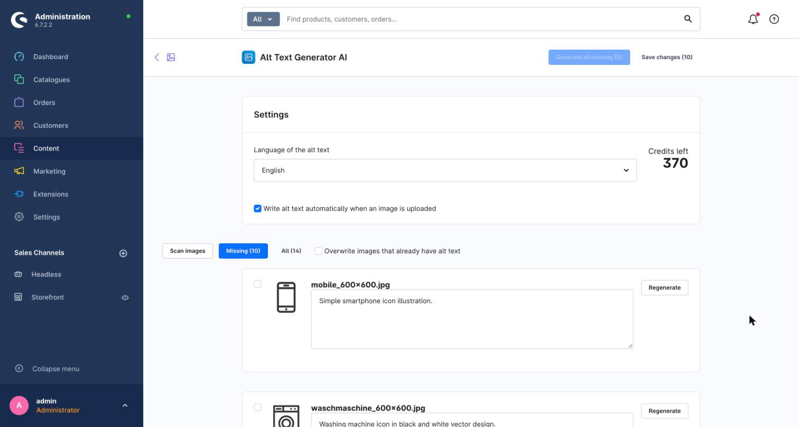
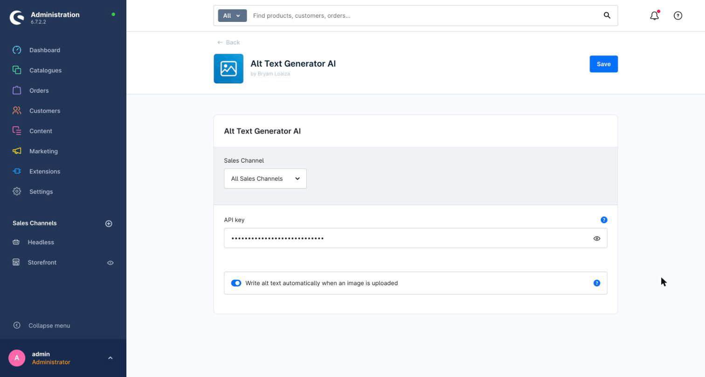
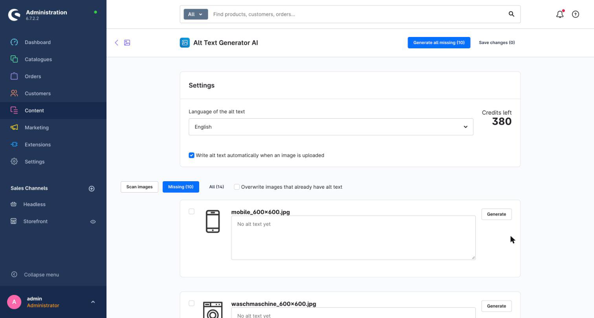

# Alt Text Generator AI for Shopware


Write SEO-friendly alt text for the images in your Shopware media library. Generate it for one image, for a selection or for every image that is missing it, or automatically when an image is uploaded. 131 languages.

[Get a free API key](https://alttextgeneratorai.com/dashboard)



## What you get

- **A bulk page.** An **Alt Text Generator AI** page under **Content** scans your media library, shows thumbnails, lists the images that have no alt text, and generates it for all of them or only the ones you tick.
- **Review before saving.** Edit any text, then save everything at once. The text goes into the media's own **Alt text** field, which your storefront already uses as the `alt` attribute of the image.
- **Automatic mode.** Turn it on and new uploads get alt text on their own, without slowing the upload down.
- **131 languages.** Choose the language of the alt text.
- **Credits shown in the administration.** One credit writes alt text for one image. New accounts get free credits.
- **Your key stays on your server.** The API key is only used by the plugin's server code and never reaches the browser.

## Requirements

- Shopware 6.7 (tested on 6.7.2)
- PHP 8.2 or newer with the GD extension, which Shopware already requires
- An Alt Text Generator API key ([get one free](https://alttextgeneratorai.com/dashboard))

## Install

Download the latest ZIP from the [releases page](https://github.com/balt1794/shopware-plugin-alt-text-generator/releases), then open **Extensions > My extensions** in your administration, click **Upload extension** and activate it.

Or install it with Composer:

```sh
composer require balt1794/alt-text-generator-ai
bin/console plugin:refresh
bin/console plugin:install --activate AltTextGeneratorAI
bin/console cache:clear
```

Then add your API key under **Extensions > My extensions > Alt Text Generator AI > Configure** and click **Save**. Leave the sales channel on **All Sales Channels**.



The administration files are already built and included, so there is nothing to compile.

## Use it

1. Open **Content > Alt Text Generator AI**. It scans your images and shows your credits.
2. **Missing** lists the images with no alt text. **All** shows everything.
3. Tick the images you want, or leave them all unticked.
4. Click **Generate selected** or **Generate all missing**. Each image uses 1 credit.
5. Read the results, change anything you like, then click **Save changes**.

**Generate all missing** skips images that already have alt text. Tick an image to generate it anyway, or tick **Overwrite images that already have alt text**.



### Automatic mode

Tick **Write alt text automatically when an image is uploaded** on the page or in the plugin settings. New uploads are queued and processed by Shopware's message queue, so uploading stays fast. The administration starts a worker for you by default. If you run workers yourself, make sure `messenger:consume async` is running. Images that already have alt text are never changed.

### Languages

The language is the language the alt text is written in. The text is saved in the language you are working in in the administration, so choose both to match.

## Privacy

When you generate alt text, a resized copy of the image (JPEG, up to 1024 px) and your API key are sent from your Shopware server to `alttextgeneratorai.com`. Images are not stored. Nothing is sent from the browser.

## Troubleshooting

| What you see | What to do |
| --- | --- |
| "Add your API key" notice | Add the key under Extensions > My extensions > Alt Text Generator AI > Configure. |
| "Invalid API key" | Copy the key again from your [dashboard](https://alttextgeneratorai.com/dashboard). |
| "No credits left on this API key" | Add credits at [alttextgeneratorai.com](https://alttextgeneratorai.com). |
| The page is missing from the Content menu | Run `bin/console cache:clear` and reload the administration. |
| Automatic mode does nothing | Make sure the message queue worker runs (`bin/console messenger:consume async`). |

## Support

support@alttextgeneratorai.com

## License

[MIT](LICENSE) © Bryam Loaiza
